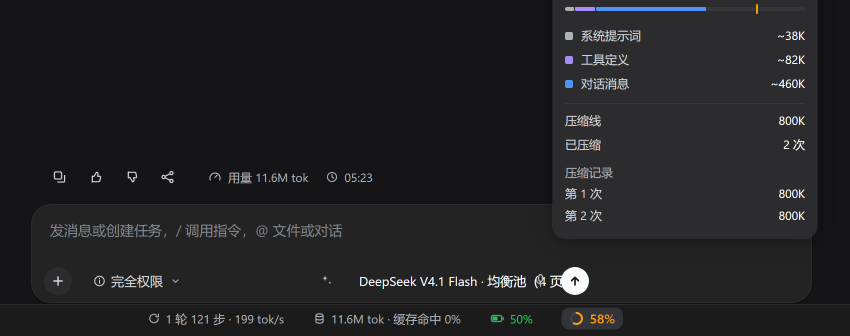

# Context compaction meter · dsh-context-compaction-meter

A DeepSeek Harness (DSH) Web GUI plugin that **merges context-compaction details into the existing context-usage window** under the composer (the popover opened from the percentage) instead of taking a separate panel.

> Version 1.1.0 · requires DSH 0.2.2-rc.2+ · no third-party dependencies, no build step

中文: [README.md](README.md)

---

## Preview

> The images below are **mockups** redrawn from a pixel-by-pixel measurement of a real 850×276 DSH window, not screenshots; the figures on screen are the plugin's own arithmetic.

Light theme: the shipped usage popover is still where it was, now carrying the compaction line, the compaction count and each compaction's threshold; the trigger chip sits at the right end of the footer strip.


Dark theme (follows the app theme; every color is a theme token); here two compactions have run and the reading sits in the yellow band:



The reading and the ring are colored by proximity to the compaction line:


---

## What the popover shows

It is still the original usage window, with compaction content added:

- Header: `X% of context used` and `~usage / window` (same as the shipped window).
- Usage bar: still segmented into system prompt / tool definitions / messages, **with a compaction-line marker drawn at the model's real trigger point**.
- Rows: after the shipped `System prompt / Tool definitions / Messages`, `Compaction line` and `Compactions` are appended, followed by each past compaction's threshold.
- No explanatory notes are rendered.

## The trigger point comes first, the line follows

Following DSH's compaction policy (`dsh-compaction-basic` defaults) and the current model capacity:

```
threshold = floor( min(W × thresholdRatio, (W − reservedOutput) − headroomTokens) )
```

This deployment: `W = 1,000,000` (1M context), reserved output `128,000` (the materialized `maxTokens` in the request header), `headroomTokens = 65,536` (default), `thresholdRatio = 0.8` (default):

```
floor( min(1,000,000 × 0.8, (1,000,000 − 128,000) − 65,536) )
= floor( min(800,000, 806,464) )
= 800,000 tokens  → 80% of the window
```

So the real trigger is **800K**, and the line is drawn at 80% of the bar (800K / 1M). Switching models (e.g. a 960K window with a 64K reservation) moves it to `min(768K, 830.4K) = 768K`, i.e. 76.8%.

## Color rule

With the line `L` as the reference (currently `L = 800K`):

- `used < 0.5L` (e.g. `< 400K`): green `--dsw-alias-state-success-primary`
- `0.5L ≤ used ≤ 0.75L` (e.g. `400K ～ 600K`): yellow `--dsw-alias-state-warn-primary`
- `used > 0.75L` (e.g. `> 600K`): red `--dsw-alias-state-error-primary`

The percentage, `~usage / window`, the ring and the line marker all follow that color, so the closer you are to compaction, the louder it gets.

## How it works

- **Host half (`index.js`)**: registers one client-visible session projection `contextCompaction` (`stateVersion: 2`) on `ctx.sessionProjections`, folding:
  - `request/context` → records `contextWindow`;
  - `request/header` → records the request's materialized `maxTokens` as the output reservation (the same value `dsh-compaction-basic` uses);
  - `compaction/summary` → counts one completed compaction, recording its threshold, `ordinal`, `compactionId` and the tokens it released.

  The threshold formula `floor(min(W × thresholdRatio, (W − reservedOutput) − headroomTokens))` mirrors the compaction backend. History keeps the latest `100` entries (`count` stays complete, `ordinal` stays truthful) so a very long session cannot bloat the projection state or the wire value; a repeated summary for the same `compactionId` is ignored. The row config is validated fail-fast inside `apply`: an unknown key, an out-of-range ratio or a non-integer headroom raises instead of silently drawing the wrong line. No model calls, no session-log writes.
- **Client half (`client.js`)**: registers on `conversation.composer.dock`. The shipped `ContextMeter` is not an extensible slot, so this plugin renders a **merged** usage window (reproducing the shipped header, segmented bar and rows, then appending the line, count and history) and hides the shipped instance with one narrowly scoped rule keyed on the shipped root's inline `anchor-name` style and excluding its own root (`[data-composer-dock] > span[style*="anchor-name"]:not([data-dsh-ccm])`). The rule lives inside this component, so disabling the plugin or having no data restores the shipped window untouched.
- Copy goes through the client locale namespace `contextCompactionMeter` (zh/en/ja); colors use theme tokens (`--dsw-alias-state-*`); the popover is portaled to `document.body` (fixed-position fallback when unavailable) and supports outside-click/Escape dismissal, focus on open and keyboard access.

## Configuration

The bundle row accepts two overrides (`cordis.patch.yml` already writes the defaults):

```yaml
- id: context-compaction-meter
  name: '@local/context-compaction-meter'
  config:
    thresholdRatio: 0.8      # keep in sync with dsh-compaction-basic.thresholdRatio
    headroomTokens: 65536    # keep in sync with dsh-compaction-basic.headroomTokens
```

If a model has its own compaction policy (`modelPolicies`), put the equivalent ratio/headroom here; otherwise the drawn line may not match that model's real trigger.

## Install

**A (recommended)**: DSH → **Plugins** → **Add plugin** → pick this folder → reload the page.

**B**: `plugin_manager install_bundle target=<absolute path to this folder>` (`application: applied` means it took effect).

> No trigger chip? Reload the page first; then restart DSH, or toggle the plugin off/on once in Plugins.

## Regenerating the mockups

`docs/images/*.png` are produced by `docs/mockups/generate.cjs`, not captured:

```bash
node docs/mockups/generate.cjs
```

Every coordinate in the script was measured pixel by pixel off a real 850×276 DSH window rather than estimated:

| Element | Measured |
|---|---|
| composer | x 31–812 (781 wide), y 145–244 (99 tall), radius 20, 1px `#ececec` |
| placeholder | 14px `#adb2b8` at x 49 |
| control row | `+` circle 43–70 (`#f5f6f7`, 28px) · circled-i 92–111 · 完全权限 112–160 · ⌄ 168–175 · ✦ 319–328 · model 358–524 · mic 532–544 · send 560–588 |
| message actions | copy 52 · up 88 · down 124 · share 160 (36px pitch) · usage 206–303 · 05:23 320–347 |
| footer strip | 1px `#e9e9e9` border at y=244, `#fafafa` fill, row right-aligned to the chip's right edge x=623 |
| popover | x 553–817 (264 wide), 38px above the bottom, 12px padding, radius 12 |

Colors are `dsh-client-ui-theme`'s literal values: light `#fafafa`/`#ffffff`/`#ececec`/`#adb2b8`/`#61666b`, dark `#212123`/`#232324`/`#2c2c2e`; chart `#adb2b8`·`#a78bfa`·`#4d93f8`; state `#22c55e`·`#f59e0b`·`#ec1313`. With the popover open the chip's background is the hover overlay `#ecedee`, not `#f5f6f7`. It renders with headless Chrome at 2x, crops the transparent margin and box-filters down to 1x. Change the script together with the UI so the two never drift. Requires Node 20+ and Chrome (or set `CHROME_PATH`).

## Caveats

- The line is **derived** from policy and capacity, not read back from history (`compaction/*` events do not record the trigger). It matches this deployment's defaults; retune the config when you retune compaction.
- The count tracks compactions that **produced a summary** (`compaction/summary`); a transaction that only pruned tool output without summarizing is not counted separately.
- Hiding the shipped meter relies on its root carrying an inline `anchor-name` style; a DSH upgrade that changes that structure needs the selector updated (or the shipped component patched directly).
- It only renders in sessions that already have usage data (reported by the provider); with no data the shipped window is used.

## License

MIT, see [LICENSE](LICENSE). Keep the license and attribution when redistributing.
