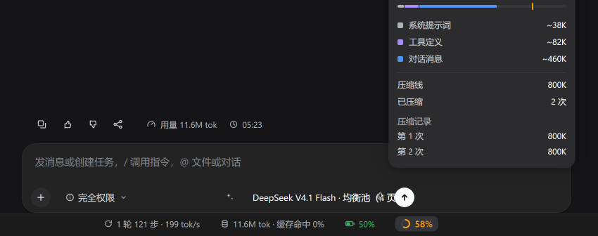

# 上下文压缩计量 · dsh-context-compaction-meter

一个 DeepSeek Harness（DSH）Web GUI 插件：把「上下文压缩」信息**直接并入输入框下方原有的上下文用量窗口**（点百分比打开的那个弹层），不再单独占用一个面板。

> 版本 1.1.0 · 需要 DSH 0.2.2-rc.2+ · 无第三方依赖、无需构建

English: [README.en.md](README.en.md)

---

## 界面预览

> 以下为按 DSH 真实窗口（850×276）**逐像素量取坐标**后重画的**模拟图**，非真机截图；图上的数字就是插件自己的算式结果。

浅色主题：输入框下方原有的用量窗口仍在原位，弹层里多了压缩线、已压缩次数与每次压缩的阈值；触发胶囊在底部状态栏最右端。


深色主题（跟随明暗主题，颜色全部走主题 token）；此时已压缩 2 次，读数落在黄色档：



用量读数与圆环按「距压缩线的接近程度」着色，越接近越醒目：


---

## 打开后看到什么

打开后看到的仍然是原来的用量窗口，只是多了压缩相关的内容：

- 顶部：`上下文已用 X%` 与 `~用量 / 窗口`（同原窗口）。
- 用量条：仍按系统提示词 / 工具定义 / 对话消息分段；**在用量条上按模型实际触发压缩的用量画出「压缩线」**。
- 明细行：原有 `系统提示词 / 工具定义 / 对话消息` 之后，追加 `压缩线` 与 `已压缩 N 次`，以及每一次压缩对应的阈值。
- 说明性文字（颜色含义、估算说明）已全部移除。

## 先确认实际触发点，再确定压缩线

按 DSH 的压缩策略（`dsh-compaction-basic` 默认值）与当前模型容量核算：

```
阈值 = floor( min(W × thresholdRatio, (W − 输出预留) − headroomTokens) )
```

本机当前模型：`W = 1,000,000`（1M 上下文），输出预留 `128,000`（请求头物化的 maxTokens），`headroomTokens = 65,536`（默认），`thresholdRatio = 0.8`（默认）：

```
floor( min(1,000,000 × 0.8, (1,000,000 − 128,000) − 65,536) )
= floor( min(800,000, 806,464) )
= 800,000 令牌  → 占窗口 80%
```

因此**实际压缩触发点为 800K**，压缩线就画在用量条的 80% 处（800K / 1M）。若切换模型（例如 960K 窗口、64K 预留），触发点相应变为 `min(768K, 830.4K) = 768K`，压缩线随之落在 76.8%。

## 颜色规则

以压缩线 `L` 为基准（当前 `L = 800K`）：

- `当前用量 < 0.5L`（如 `< 400K`）：绿色 `--dsw-alias-state-success-primary`
- `0.5L ≤ 当前用量 ≤ 0.75L`（如 `400K ～ 600K`）：黄色 `--dsw-alias-state-warn-primary`
- `当前用量 > 0.75L`（如 `> 600K`）：红色 `--dsw-alias-state-error-primary`

百分比读数、`~用量 / 窗口`、圆形进度环与压缩线标记都会按此着色，越接近压缩线越醒目。

## 实现说明

- **Host 半（`index.js`）**：向 `ctx.sessionProjections` 注册客户端可读投影 `contextCompaction`（`stateVersion: 2`），折叠：
  - `request/context` → 记录 `contextWindow`；
  - `request/header` → 记录该请求物化的 `maxTokens` 作为输出预留（与 `dsh-compaction-basic` 用的是同一个值）；
  - `compaction/summary` → 每成功压缩一次计一次，并记录当次阈值、序号（`ordinal`）、`compactionId` 与释放的 token 数。

  阈值公式 `floor(min(W × thresholdRatio, (W − 输出预留) − headroomTokens))` 与压缩后台保持一致。历史记录最多保留最近 `100` 条（`count` 仍为完整计数，`ordinal` 保持真实序号），避免超长会话撑大投影状态与 wire 体积；同一 `compactionId` 的重复 summary 会被忽略。行配置在 `apply` 内做**快速失败校验**：未知键、越界比例、非整数余量都会直接报错，而不是静默画错压缩线。无模型调用，不写会话日志。
- **Client 半（`client.js`）**：注册到 `conversation.composer.dock`。内置的 `ContextMeter` 不是可扩展插槽，所以本插件渲染一个**合并版**用量窗口（复刻原有头部、分段条、明细行，并追加压缩线/次数/记录），并用一条仅作用于输入框停靠区、且只命中内置组件根节点的规则（`[data-composer-dock] > span[style*="anchor-name"]:not([data-dsh-ccm])`）隐藏内置实例，避免出现两个窗口。该规则写在本组件内，因此插件禁用或无数据时，内置用量窗口原样恢复。
- 文案走客户端 locale 命名空间 `contextCompactionMeter`（中/英/日）；颜色使用主题 token（`--dsw-alias-state-*`）；弹层通过 `createPortal` 渲染到 `document.body`（不可用时回退为固定定位），支持点击外部/按 Esc 关闭、打开时聚焦、键盘可达。

## 自定义配置

bundle 行可覆盖两项（`cordis.patch.yml` 已写出默认值）：

```yaml
- id: context-compaction-meter
  name: '@local/context-compaction-meter'
  config:
    thresholdRatio: 0.8      # 与 dsh-compaction-basic.thresholdRatio 保持一致
    headroomTokens: 65536    # 与 dsh-compaction-basic.headroomTokens 保持一致
```

若为某模型单独配置了压缩阈值（`modelPolicies`），请把等效的比例/余量填到这里；否则显示可能与该模型的实际触发点不一致。

## 安装

**方式 A（推荐）**：DSH → **Plugins** → **Add plugin** → 选择本文件夹 → 刷新页面。

**方式 B**：`plugin_manager install_bundle target=<本文件夹绝对路径>`（返回 `application: applied` 即生效）。

> 按钮没出现：先刷新页面；仍没有就重启 DSH，或在 Plugins 里禁用/启用一次。

## 模拟图怎么生成

`docs/images/*.png` 由 `docs/mockups/generate.cjs` 生成，不是截图：

```bash
node docs/mockups/generate.cjs
```

脚本里的每个坐标都是从真实 DSH 窗口（850×276）逐像素量出来的，不是估的：

| 元素 | 实测值 |
|---|---|
| 输入框 | x 31–812（781 宽），y 145–244（99 高），圆角 20，1px `#ececec` |
| 占位文字 | 14px `#adb2b8`，x 49 |
| 控件行 | `+` 圆 43–70（`#f5f6f7`，28px）· 圆形 i 图标 92–111 · 完全权限 112–160 · ⌄ 168–175 · ✦ 319–328 · 模型名 358–524 · 麦克风 532–544 · 发送 560–588 |
| 消息操作行 | 复制 52 · 赞 88 · 踩 124 · 分享 160（36px 间距）· 用量 206–303 · 05:23 320–347 |
| 底部状态栏 | y=244 处 1px `#e9e9e9` 上边框，`#fafafa` 填充，整排右端对齐到胶囊右缘 x=623 |
| 弹层 | x 553–817（264 宽），距底部 38px，内边距 12，圆角 12 |

配色取 `dsh-client-ui-theme` 实值：浅色 `#fafafa`/`#ffffff`/`#ececec`/`#adb2b8`/`#61666b`，深色 `#212123`/`#232324`/`#2c2c2e`；图表色 `#adb2b8`·`#a78bfa`·`#4d93f8`；状态色 `#22c55e`·`#f59e0b`·`#ec1313`。弹层打开时胶囊底色是悬停叠加色 `#ecedee`（不是 `#f5f6f7`）。渲染用 headless Chrome 2x，裁掉透明边后 box-filter 降到 1x。改界面时同步改脚本，图和实现就不会漂。需要 Node 20+ 与 Chrome（或设 `CHROME_PATH`）。

## 需要注意

- 压缩线是**按策略与模型容量推算**的触发点，而非从历史事件回读（`compaction/*` 日志本身不记录触发阈值）。它与本部署的默认策略一致；改动实际压缩配置时要同步本插件配置。
- 压缩次数统计的是**成功产生摘要**的压缩（`compaction/summary`）；仅裁剪工具输出（prune）而未生成摘要的事务不单独计次。
- 隐藏内置用量窗口依赖其根节点带内联 `anchor-name` 样式；DSH 升级若改动该结构，需要同步调整选择器（或改为直接改内置组件）。
- 只有在存在上下文用量数据（provider 已上报）的会话中才显示；无数据时回退为内置用量窗口。

## 许可

MIT，见 [LICENSE](LICENSE)。转载请保留许可与来源说明。
